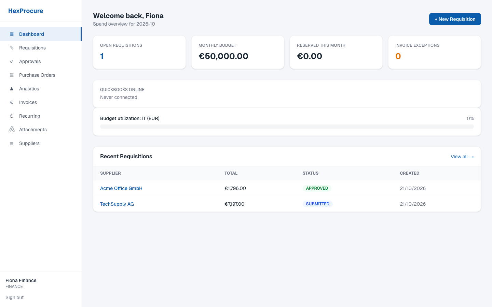
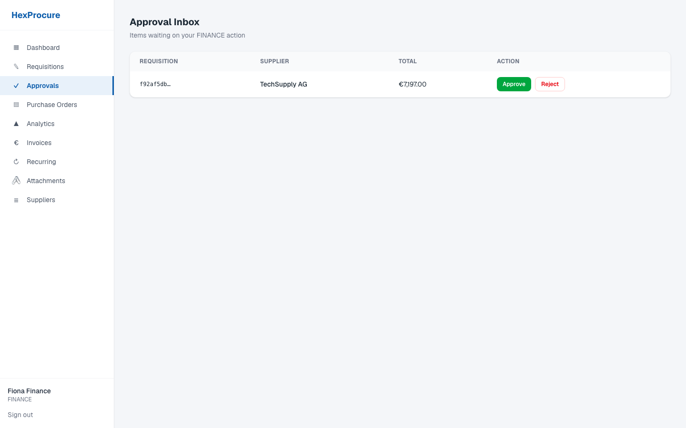
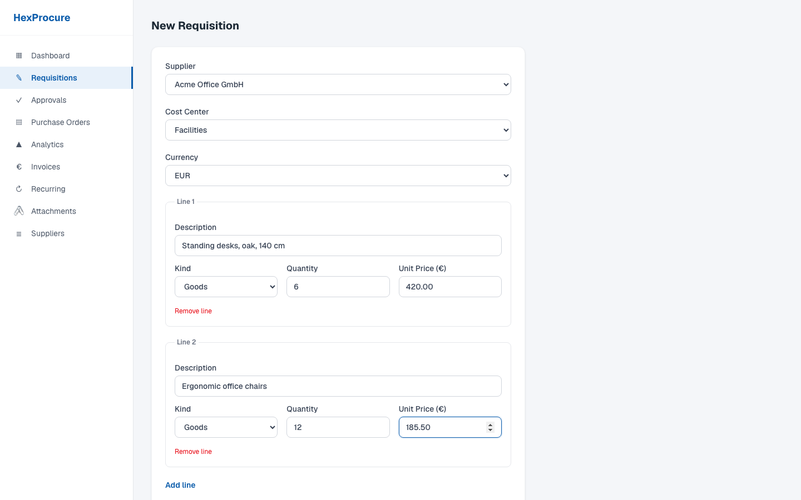
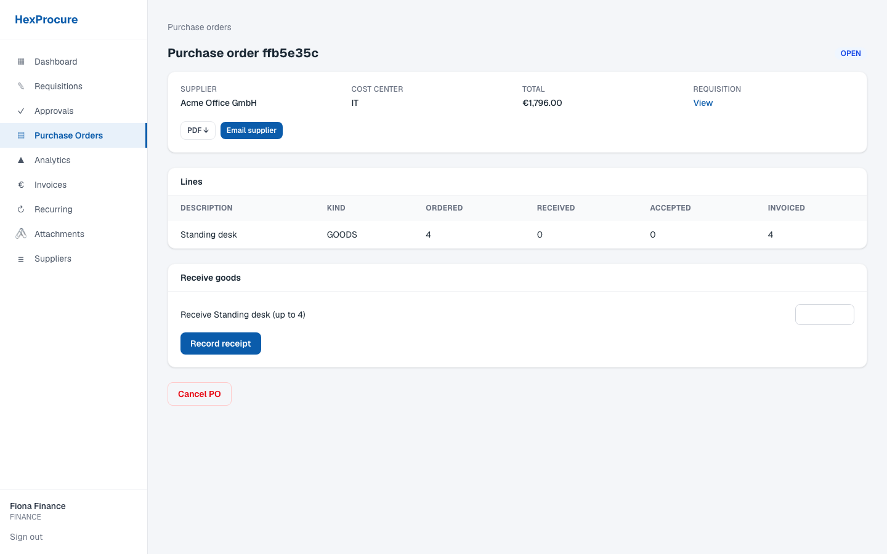
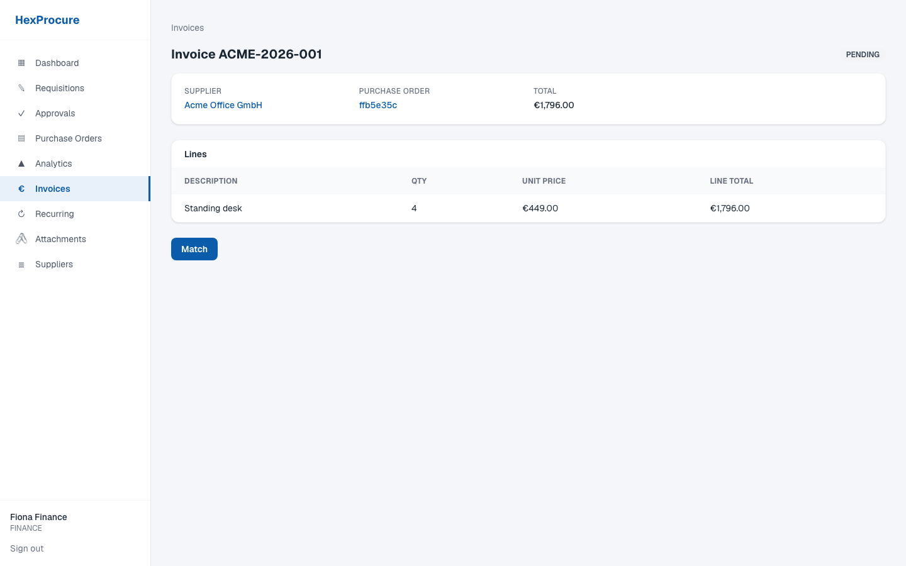
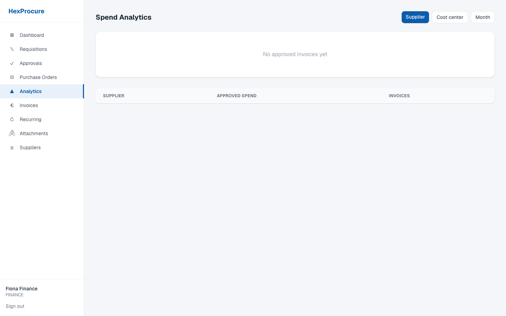
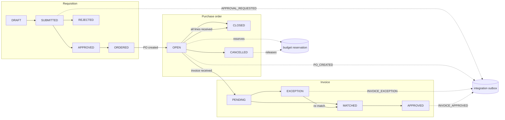

# HexProcure

Open-source procure-to-pay for small and mid-sized businesses: requisitions, rule-based approvals, purchase orders, goods receipt and invoice matching, with budget control, ERP/AP integrations and AI-assisted invoice intake.

**Status:** v0.1.0. The procure-to-pay loop for indirect spend (goods and services a business buys to run itself, not production inventory) works end to end in the API and the UI. See [Known gaps](#known-gaps) before deploying. Changes are tracked in the [CHANGELOG](CHANGELOG.md).

## Why

Small teams manage purchasing over email and spreadsheets: no approval control, no PO trail, invoice mismatches discovered at month-end. Enterprise suites cost thousands per month and take weeks to implement. HexProcure covers the core procure-to-pay loop and runs on your own server.

## Functionality

### Procure-to-pay workflow

The core loop walks a purchase through five stages, each enforced by domain logic:

1. **Requisition**: any user creates a request with line items (description, quantity, unit price) against a supplier and cost center.
2. **Approval**: submitting resolves an approval chain from configured amount-band rules (see below) and creates one approval task per step. Approvers see only tasks matching their role; admins can act on any step.
3. **Purchase order**: once every step approves, ordering generates a PO with lines mirrored from the requisition. This is where the budget guard runs.
4. **Goods receipt**: receipts are recorded per PO line; cumulative received quantity can never exceed ordered quantity. A fully-received PO closes automatically.
5. **Invoice matching**: invoices are matched against the PO and receipts (details below). Goods lines are 3-way (PO, receipt, invoice); service lines are 2-way (PO and invoice, plus an accepted-amount check). Only `MATCHED` invoices can be approved, by FINANCE or ADMIN.

Every state change appends an immutable audit event (`who`, `what`, `when`, payload).

### Approval engine

Rules are amount ranges, e.g.:

| Rule | Range | Approver |
|---|---|---|
| 1 | €0 – €500 | MANAGER |
| 2 | €500 – €5,000 | MANAGER |
| 3 | ≥ €5,000 (open-ended) | FINANCE |

- A requisition's total matches at most **one bounded band**: the one whose range contains it, with limits inclusive and the higher band winning on a shared boundary.
- Every **open-ended rule** (no maximum) whose minimum is at or below the total is added as a later step, in order of minimum. With the rules above, €9,000 matches no bounded band and one open-ended rule, so FINANCE approves alone. €5,000 matches band 2 and rule 3, so MANAGER approves first and FINANCE second.
- A different rule set can stack open-ended rules: with "MANAGER from €0" and "FINANCE from €2,000", a €6,000 request needs both, in sequence.
- Overlapping bounded bands and rules in mixed currencies are rejected when a requisition is submitted and its chain is resolved. An amount that matches no rule cannot be submitted; there is no automatic escalation.

### Budget control

Monthly budgets per cost center. Ordering fails when the cost center has no budget for the current month. Creating a PO **reserves** its total atomically (`SELECT … FOR UPDATE` serializes concurrent orders, so two buyers can never double-spend the same budget). Cancelling a PO releases its reservation. Ordering without sufficient budget fails with a distinct `BUDGET_EXCEEDED` error carrying the available amount.

### Invoice matching

Each goods line on an invoice is checked four ways:

| Check | Rule |
|---|---|
| `UNMATCHED_LINE` | line has no PO reference or points at an unknown PO line |
| `QUANTITY_MISMATCH` | cumulative invoiced quantity (this + prior invoices on the same PO line) exceeds received quantity |
| `OVER_INVOICED` | cumulative invoiced quantity (this + prior invoices on the same PO line) exceeds ordered quantity |
| `PRICE_MISMATCH` | unit price deviates from the PO price by more than max(2% of the PO price, 0.5 minor units) |

Service lines are checked by amount instead: `OVER_INVOICED_AMOUNT` when the cumulative invoiced amount exceeds the ordered amount, `SERVICE_NOT_ACCEPTED` when it exceeds the accepted amount.

Clean invoices become `MATCHED`; anything else lands in `EXCEPTION` with a structured exception list for review. Approved invoices emit integration events (below).

### Money handling

All amounts are **integers in the smallest currency unit** (called minor units in the code) wrapped in a currency-aware `Money` value object. Arithmetic refuses mixed currencies, negative results (unless explicitly allowed), and fractional minor units. No floats touch a balance anywhere.
The UI formats every amount in its own row's currency with `formatMoney` in `src/lib/format.ts`. The formatter knows each currency's decimals (JPY has 0), but JPY is formatter-only. Analytics totals are grouped per currency and never summed across currencies. Requisitions accept EUR, USD, GBP, CZK, PLN or CHF.

### Integrations (ERP/AP connectivity)

Domain events are `PO_CREATED`, `PO_CANCELLED`, `INVOICE_APPROVED`, plus the notification events `APPROVAL_REQUESTED`, `REQUISITION_DECIDED`, `INVOICE_EXCEPTION` and `INTEGRATION_ERROR`. Each is written to a **transactional outbox** in the same database transaction as the business change, so a failed delivery does not lose the event. A dispatch loop drains pending events through registered connectors:

| Connector | Target | Delivery semantics |
|---|---|---|
| **CSV flat-file** | Any ERP/AP with a file import | Wide-format rows (header + line records), RFC-4180 escaping, stable column order; appended to one file per day and event type in `INTEGRATION_CSV_DIR` (off when unset) |
| **Generic webhook** | Zapier/Make/custom HTTP endpoints (`INTEGRATION_WEBHOOK_URL`) | Signed POSTs (`X-HexProcure-Signature`, HMAC-SHA256), 4xx = non-retryable, 5xx/429/network = retryable |
| **Email notifications** | Approvers, requesters, finance | Approval requests, decisions, and invoice exceptions via SMTP (`SMTP_URL`); log-only mode when unset |
| **QuickBooks Online** | QBO `PurchaseOrder` / `Bill` (`QBO_CLIENT_ID`, `QBO_CLIENT_SECRET`, `INTEGRATION_ENC_KEY`, `INTEGRATION_REDIRECT_URI`; `QBO_SANDBOX` defaults to the sandbox, `false` is live) | OAuth connection, idempotent push; vendors are matched by DisplayName or created, and cached in `qbo_sync_map`; minor-unit to decimal conversion at the boundary only |

Each event type can have several connectors, and every connector that handles that event type receives the event. The registry is built from the environment: CSV when `INTEGRATION_CSV_DIR` is set, email always, QuickBooks when configured, webhook when configured. Delivery is tracked per connector in `integration_events.delivered_connectors`. An event is `DELIVERED` once all of its connectors succeed, and a failed connector is retried alone on the next run while the others are not called again.

Failed retryable deliveries stay `PENDING` with attempt counts and last error. They are retried on the next dispatch. Trigger dispatch with `POST /api/v1/integrations/dispatch` (FINANCE/ADMIN), for example from cron.

You can also set `INTEGRATION_DISPATCH_INTERVAL_MS` (e.g. `60000`) to run dispatch from an in-process scheduler. The scheduler rebuilds the connector registry on every run, so it delivers in a fresh process and the cron call is optional. It is single-instance, so only one app container should run it.

#### MCP server

`services/mcp` is a standalone, read-only [MCP](https://modelcontextprotocol.io) server (stdio) that lets an agent such as Claude Desktop, Claude Code or Cursor read procurement state through the REST API. It never touches the database. Tools: `list_requisitions`, `get_requisition`, `list_purchase_orders`, `get_purchase_order`, `list_invoices`, `get_invoice` (with match exceptions) and `spend_summary`; resources `hexprocure://po/{id}` and `hexprocure://invoice/{id}`. Amounts come back as minor units plus a formatted string in the row currency. The server acts with the role of the token's user, so `spend_summary` needs a FINANCE or ADMIN token.

| Variable | Meaning |
|---|---|
| `HEXPROCURE_URL` | Base URL of the app (required) |
| `HEXPROCURE_TOKEN` | API token `hxp_...` from `POST /api/v1/auth/tokens` (required) |
| `HEXPROCURE_TIMEOUT_MS` | Per-request timeout, default `10000` |

Build with `cd services/mcp && npm install --ignore-scripts && npm run build`, then register it, for example in the Claude Desktop config:

```json
{
  "mcpServers": {
    "hexprocure": {
      "command": "node",
      "args": ["/path/to/hexprocure/services/mcp/dist/index.js"],
      "env": {
        "HEXPROCURE_URL": "https://hexprocure.example.com",
        "HEXPROCURE_TOKEN": "hxp_replace_with_your_token"
      }
    }
  }
}
```

Read-only today: writes and approvals are not exposed.

## AI functionality

HexProcure includes an **AI-assisted invoice intake pipeline** that turns unstructured invoice documents into reviewable drafts:

```
invoice.pdf ──▶ POST /api/v1/invoices/extract
                  │
                  ├─▶ OCR sidecar (PaddleOCR, self-hosted Python service)
                  │     • renders PDF pages / reads images
                  │     • returns raw text + per-line confidence
                  ▼
               Text parser (deterministic, rule-based)
                  • invoice number   (labeled patterns: "Invoice", "Rechnung", …)
                  • issue date       (ISO and DD.MM.YYYY formats)
                  • grand total      (labeled-total preference, EU decimal-comma aware,
                                      converted to integer minor units)
                  • VAT ID           (EU-style country-prefixed pattern)
                  • confidence flag  (HIGH = total plus number or date found;
                                      LOW = human must fill blanks)
                  ▼
               Draft response → human reviews/edits → invoice created
                  → existing 2/3-way matching takes over
```

Design decisions worth knowing:

- **Self-hosted OCR.** The sidecar wraps [PaddleOCR](https://github.com/PaddlePaddle/PaddleOCR); documents never leave your infrastructure. It runs as an isolated FastAPI service (`services/ocr/`, Dockerfile included) so the heavy ML dependencies stay out of the main app. Enable by setting `INTEGRATION_OCR_URL=http://localhost:8100`.
- **Human-in-the-loop by design.** Extraction produces a *draft*, never an auto-created invoice. Low-confidence fields are surfaced as `null` rather than guessed.
- **Deterministic header, optional LLM lines.** Header fields (number, date, total, VAT ID) use tested regex rules. Line items are extracted by an LLM only when `ANTHROPIC_API_KEY` is set; `POST /api/v1/invoices/extract` then accepts an optional `purchaseOrderId` and also returns `lines` mapped to that PO's lines, with `linesSource: "llm"`. Without the key, `linesSource` is `"none"` and nothing leaves the server.

### What leaves the server when the LLM provider is on

With `ANTHROPIC_API_KEY` set, the OCR text of each uploaded invoice and the line descriptions, quantities and unit prices of the selected purchase order are sent to Anthropic's API. Invoice text is treated as untrusted data in the prompt. Every call, successful or failed, is recorded in the `llm_usage` table (model, token counts, duration, acting user). Set `INTEGRATION_LLM_MODEL` to change the model; leave the key unset to keep all processing on your infrastructure. Proposed lines are never saved automatically: a person reviews them and creates the invoice as usual.

## Auth

Email and password login at `/login`. Registration is API-only (`POST /api/v1/auth/register`): the login page has no registration form. Passwords are hashed with scrypt (unique per-user salt). Sessions are HMAC-SHA256–signed tokens stored in `HttpOnly` / `SameSite=Lax` cookies with 7-day expiry; signature and expiry checks use timing-safe comparison. Each login also stores a `sessions` row (SHA-256 of the token, never the token) and a request is accepted only while that row exists, is not revoked and has not expired. `POST /api/v1/auth/logout` revokes the current session; an ADMIN can revoke all sessions of a user with `POST /api/v1/users/:id/sessions/revoke` (audited as `SESSIONS_REVOKED`). Rows expired more than 30 days are purged on login. Role-based authorization (REQUESTER / MANAGER / FINANCE / ADMIN) is enforced per endpoint and in the UI.

- **Upgrading from stateless sessions:** tokens issued before migration `0009_sessions` have no session row and are rejected, so every user is logged out once on deploy.
- **Self-registration** always creates a `REQUESTER`; a client-supplied role is ignored. Set `ALLOW_SELF_REGISTRATION=true` to enable it in production (it is open by default in development, `false` disables it anywhere). Other roles are assigned in the database.
- **`AUTH_SECRET`** must be at least 32 characters and not a known placeholder (`openssl rand -hex 32`); the app refuses to start otherwise.
- **Rate limiting** is in-memory per instance. Limits per minute and per client are 10 for login and register, 60 for API writes and 300 for API reads (env overrides in [docs/deployment.md](docs/deployment.md) §6).
- **Client bucket:** the right-most `X-Forwarded-For` hop, else `X-Real-IP`. Both headers are read only when `TRUST_PROXY=true`, so set it behind a proxy you control. The value must be a valid IPv4/IPv6 literal of at most 45 characters. Otherwise every client shares one bucket named `direct`.
- **Key stores:** the API, auth and per-email limits each have their own bounded key store (10,000 keys), so one cannot fill another. A single client bucket may own at most 64 live keys. On the API and auth limits its extra keys share an overflow bucket keyed by that client, so a client that floods keys only throttles itself. On the per-email limit it evicts its own least recently used pair instead, so every tracked pair stays resettable. Expired entries are dropped first, and live counters are never evicted on the API and auth limits.
- **Login limits:** the per-email limit is keyed on email plus client bucket and counts failed attempts only. A success clears only that exact pair. Logins for unknown emails verify against a dummy hash so response timing does not reveal which accounts exist.

## UI

A sidebar groups the work areas: dashboard, requisitions, approvals, purchase orders, invoices, analytics, recurring orders, attachments and suppliers. The dashboard shows KPI cards (open requisitions, monthly budget, reserved spend, invoice exceptions) and a budget utilization bar. The approval inbox lets an approver approve or reject inline. List views use color-coded status pills, and detail pages cover requisitions, purchase orders, invoices and suppliers. The requisition form takes multiple lines and a currency. Invoice capture prefills the form from OCR.

An Admin group in the sidebar holds the master data pages: Manage suppliers, Cost centers, Budgets and Approval rules (`/admin/...`). Each page lists the records, has a create form and an edit form, and archives a record instead of deleting it. Suppliers and cost centers also take a CSV upload. ADMIN sees all four pages; FINANCE sees suppliers and budgets and can create and edit there, but not archive or import. Archived suppliers and cost centers cannot be picked on new requisitions. The suppliers list links to the admin form, and each supplier has a detail page with its purchase orders and invoices.

<table>
  <tr>
    <td></td>
    <td></td>
  </tr>
  <tr>
    <td></td>
    <td></td>
  </tr>
  <tr>
    <td></td>
    <td></td>
  </tr>
</table>

## Roadmap

Delivered in v0.1.0: machine API tokens, CSRF + rate limiting, spend analytics,
UI for the procure-to-pay loop, Playwright E2E suite, Docker Compose deployment (§7–§12 of
[docs/mvp3-spec.md](docs/mvp3-spec.md)). QBO live OAuth sync is built
([docs/qbo-live-spec.md](docs/qbo-live-spec.md) §12); next candidates:
Redis-backed rate limiting for multi-node installs, and S3 attachment storage.

## Deployment

The [deployment guide](docs/deployment.md) is the full step-by-step production
guide: server prep, configuration reference, role model, systemd/cron setup,
nginx+TLS, backups and a go-live checklist. It also documents a **Docker Compose
variant** (app + Postgres 16 + OCR sidecar), started with
`docker compose up -d --build`.

## Stack

Next.js 16 (App Router) · TypeScript · PostgreSQL · Drizzle ORM · Tailwind CSS 4 · Vitest · Playwright · FastAPI sidecar for OCR

## Quick start

Prereqs: Node 22+ and PostgreSQL 16. (Optional, for AI intake: Docker for the OCR sidecar.)

```bash
createdb hexprocure             # empty database; DATABASE_URL in .env must point at it
npm install
cp .env.example .env            # then set DATABASE_URL and AUTH_SECRET (openssl rand -hex 32)
node --env-file=.env scripts/migrate.mjs   # apply schema (the script does not read .env itself)
npx tsx scripts/seed.ts         # demo users + data (loads .env itself)
npm run dev                     # http://localhost:3000/login
```

Demo logins (password `password123`): `rita@hexprocure.dev` (requester), `max@hexprocure.dev` (manager), `fiona@hexprocure.dev` (finance), `admin@hexprocure.dev` (admin).

### Enabling AI invoice intake (optional)

```bash
cd services/ocr
docker build -t hexprocure-ocr . && docker run -p 8100:8100 hexprocure-ocr
# then add INTEGRATION_OCR_URL=http://localhost:8100 to .env and restart
```

First start downloads the PaddleOCR models (~hundreds of MB). To test, log in at `/login` first and copy the `hexprocure_session` cookie value from your browser:

```bash
curl -F "file=@invoice.pdf" \
  -H "Cookie: hexprocure_session=<token>" \
  http://localhost:3000/api/v1/invoices/extract
```

## Scripts

```bash
npm run dev          # dev server
npm run build        # production build
npm run lint         # eslint
npx tsc --noEmit     # typecheck
npx vitest run             # unit + integration tests (50 files, 421 tests)
npx vitest run --coverage  # with coverage gate on business logic
npm run test:e2e           # Playwright suite, 12 tests in 7 files (builds, boots on :3100, DB from .env.e2e)
node --env-file=.env scripts/migrate.mjs   # apply schema migrations (new migration from schema edits: npx drizzle-kit generate)
```

Tests use their own databases via `.env.test` / `.env.e2e` so they never touch dev data.

## Architecture

```
src/
  domain/       Pure business logic (money, approvals, budgets, matching). No I/O.
  lib/
    services/   Transactional flows wiring domain ↔ Postgres
    api/        Auth + error mapping for route handlers
    integrations/ Outbox dispatch, connectors (CSV, webhook, QBO),
                  OCR provider + invoice text parser
    db/         Drizzle schema + client
  app/          Next.js routes & API handlers (thin adapters)
services/
  ocr/          Self-hosted PaddleOCR sidecar (Python/FastAPI)
```

Dependency rule: `app → lib → domain`; the domain layer is pure and fully unit-tested (coverage gate of 80% on `src/domain`, `src/lib/services` and `src/lib/api`). API contract and product brief live in [`docs/`](docs/).

Document flow (state names from `src/lib/db/schema.ts`):



## Known gaps

- QBO live sync is built: OAuth connect, encrypted rotating tokens, idempotent PO/Bill push, and revoke/expiry notifications. It is covered by stubbed tests.
- The live contract smoke (`npm run test:qbo-live`, see [docs/qbo-live-spec.md](docs/qbo-live-spec.md) §12) still needs Intuit sandbox credentials. Production OAuth needs a public HTTPS redirect URI.
- Rate limiting is single-instance in-memory; multi-node deployments need a Redis adapter, which does not exist yet

## Editions

The core in this repository is MIT and free to self-host with no seat cap.
[`ee/`](ee/) carries the source-available [HexProcure Commercial Licence](ee/LICENSE)
(a draft) and `ee/features.ts`, the map from planned paid features (AI lanes,
connector packs, SSO and more) to the tier that will unlock them. No feature is
gated yet: everything in v0.1.0 works without a key. A license key in
`HEXPROCURE_LICENSE`, verified offline against `HEXPROCURE_LICENSE_PUBLIC_KEY`,
sets the tier shown by `GET /api/v1/license`; without a valid key the app runs
as Community. Tiers and prices:
[docs/pricing-tiers.md](docs/pricing-tiers.md).

## License

MIT, see [LICENSE](LICENSE). The `ee/` directory carries its own license, see [ee/LICENSE](ee/LICENSE).
