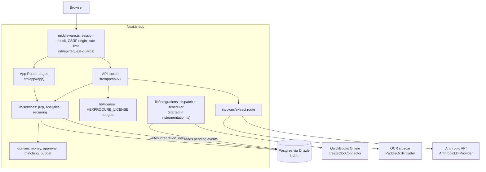

# HexProcure Architecture



SMB procure-to-pay: Requisition → Approval → PO → Receipt → Invoice match, with budget control and spend analytics.

## Layering

```
src/
  domain/        Pure business logic. No I/O, no framework imports. Fully unit-tested.
    money.ts         Minor-unit integer money + currency-aware arithmetic
    approval.ts      Approval chain resolution & routing
    matching.ts      2/3-way invoice matching
    budget.ts        Budget check / reservation
    invoice-lines.ts Normalisation of LLM-proposed invoice lines
  lib/           services/ (transactional flows), integrations/ (outbox, connectors,
                 OCR, LLM), db/ (Drizzle schema + client), api/ (auth, guards,
                 error mapping). Integration-tested against Postgres.
  app/           Next.js routes & API handlers. Validation only; delegates to lib services.
```

**Dependency rule:** `app → lib → domain`. Domain never imports upward.

## Core model

- **Money**: integers in the smallest currency unit (minor units). Never floats.
- **ApprovalRule**: `{ minAmount, maxAmount?, approverRole }`. A requisition gets at
  most one bounded band (limits inclusive; on a shared boundary the higher band wins)
  plus every open-ended rule (no `maxAmount`) whose `minAmount` is at or below the
  amount, as later steps. An amount that matches no rule cannot be submitted; there is
  no automatic escalation.
- **Budget**: monthly budget per cost center. Guard returns `ok | exceeded(available)`.
  PO creation reserves; cancellation releases.
- **Matching**: invoice lines vs PO lines vs receipts.
  - tolerance: qty ±0%, price ±2% or ±0.50 minor units/unit, whichever greater
  - status: `MATCHED` | `EXCEPTION`, with exceptions `UNMATCHED_LINE` | `QUANTITY_MISMATCH` |
    `OVER_INVOICED` | `PRICE_MISMATCH` (goods) and `OVER_INVOICED_AMOUNT` | `SERVICE_NOT_ACCEPTED` (services)

## Invariants (enforced by domain, tested first)

1. Money never negative unless explicitly allowed (credit notes).
2. A requisition cannot exceed remaining budget at PO time.
3. An invoice cannot be approved while status ≠ MATCHED (`EXCEPTION` invoices stay open for review and can be re-matched).
4. Total invoiced against a PO line can never exceed ordered quantity (over-invoicing).
5. Every state change appends an audit event.

## Testing strategy

- Unit (Vitest): domain, RED→GREEN→REFACTOR per behavior; 80% coverage thresholds
  over `src/domain`, `src/lib/services` and `src/lib/api`.
- Integration: services and API routes against a real Postgres test database
  (`hexprocure_test`, configured in `.env.test`), never the dev database.
- E2E (Playwright): 12 tests in 7 files, including the requisition to PO to receipt
  to invoice happy path in the UI.
