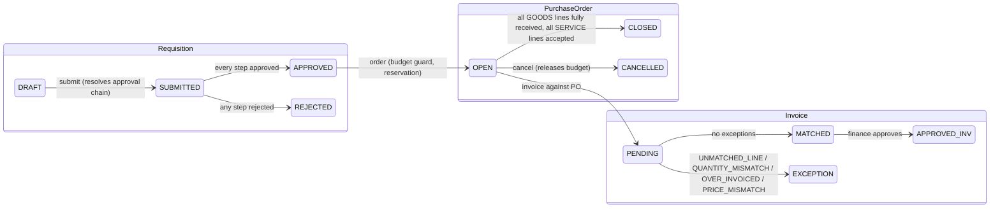
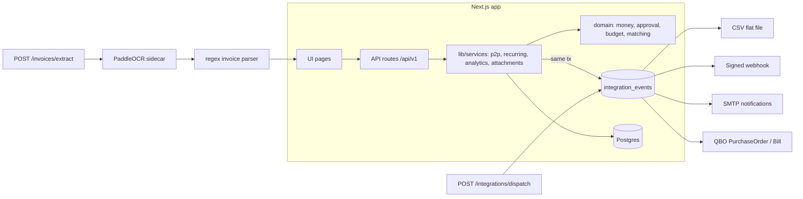

# HexProcure v0.1.0: Functional Specification (as built)

Written 2026-10-20 from the code on `main` (commit `ci(claude-fix)…`, 2026-09-24).
This document describes what the software does today. Roadmap lives in
`ai-roadmap.md`; the review that accompanies this spec lives in `review-2026-10-20.md`.

## 1. Purpose and users

Self-hosted procure-to-pay for 10–50 person companies. Replaces email and
spreadsheets with a controlled loop: request, approve, order, receive, match
invoice, export to the accounting system.

| Role | Can do |
|---|---|
| REQUESTER | create requisitions, record receipts, upload attachments, view own data |
| MANAGER | everything above, plus approve or reject approval tasks routed to MANAGER |
| FINANCE | everything above, plus invoice create/match/approve, analytics, dispatch outbox, run recurring templates |
| ADMIN | everything, plus approval rules, budgets, API tokens, QBO connect/disconnect, any approval step |

Auth: email + password (scrypt), HMAC-SHA256 signed session cookie (7 days,
`HttpOnly`, `SameSite=Lax`), plus machine API tokens (`Bearer hxp_…`, SHA-256
hashed at rest, ADMIN-managed, revocable). Middleware enforces CSRF origin
checks and in-memory rate limits (auth 10/min, mutation 60/min, read 300/min
by default) on every `/api/*` route.

## 2. Core flow

### 2.1 Requisition
- Created by any user against one supplier and one cost center, single currency (default EUR), with lines `{description, quantity, unitPriceMinor, kind: GOODS|SERVICE}`.
- Submit resolves the approval chain from `approval_rules` (ordered amount bands with `minMinor`, optional `maxMinor`, `approverRole`). Total falls in exactly one band; boundary amounts go to the higher band; open-ended bands act as escalation steps so one requisition can need several sequential approvals. Overlapping bands and mixed currencies are rejected at rule configuration.
- One `approvals` row per step. Approvers see only their role's tasks; ADMIN can decide any step. Reject on any step rejects the requisition.
- Order templates (`order_templates`, cadence MONTHLY / QUARTERLY / YEARLY, `nextRunDate`) generate DRAFT requisitions when `POST /order-templates/run` is called; idempotent per day via row locks.

### 2.2 Purchase order
- `POST /requisitions/:id/order` on a fully approved requisition creates a PO with lines mirrored from the requisition.
- Budget guard: monthly budget per cost center (`budgets`, keyed by `yearMonth`). PO creation reserves its total in `budget_reservations` inside one transaction with `SELECT … FOR UPDATE`, so concurrent orders cannot double-spend. Insufficient budget fails with `BUDGET_EXCEEDED` carrying the available amount. Cancel releases the reservation.
- PO PDF (`@react-pdf/renderer`) in two variants: `supplier` (no cost center or requester) and `internal`. `POST /purchase-orders/:id/send` emails the supplier variant via SMTP and writes a `PO_SENT` audit event; allowed only while OPEN.
- Lines can be edited via `PATCH /purchase-orders/:id/lines` while OPEN.

### 2.3 Goods receipt
- Receipts per PO line. GOODS: cumulative received ≤ ordered, enforced in the domain. SERVICE: acceptance flag instead of quantity.
- PO auto-closes when every GOODS line is fully received and every SERVICE line has at least one acceptance.

### 2.4 Invoice and matching
- Invoice `{supplierId, purchaseOrderId, number, lines[{poLineId?, quantity, unitPriceMinor, amountMinor?}]}`. Invoice number is unique per supplier.
- Matching (`src/domain/matching.ts`) checks each line: `UNMATCHED_LINE` (no or unknown PO line), `QUANTITY_MISMATCH` (invoiced > received), `OVER_INVOICED` (cumulative invoiced across invoices > ordered), `PRICE_MISMATCH` (deviation > max(2 %, 0.005 EUR)). SERVICE lines compare `amountMinor` against the PO line amount.
- Clean result → `MATCHED`; otherwise `EXCEPTION` with a structured exception list stored on the invoice. Only `MATCHED` invoices can be approved (FINANCE/ADMIN). Approval emits `INVOICE_APPROVED` to the outbox.

### 2.5 AI-assisted invoice intake (current state)
- `POST /invoices/extract` (multipart PDF/image) → PaddleOCR sidecar (`services/ocr`, FastAPI, self-hosted) returns text + per-line confidence → deterministic regex parser (`invoice-parser.ts`) extracts invoice number, issue date, grand total (EU decimal-comma aware, minor units), VAT ID, and a HIGH/LOW confidence flag.
- Output is a draft for a human to complete. No line items are extracted. No LLM is involved. Feature is disabled unless `INTEGRATION_OCR_URL` is set.

### 2.6 Attachments
- Files on requisitions, POs, invoices. Allowlist pdf/png/jpeg/webp/txt/zip, ≤10 MB, stored on local disk (`file-store.ts`) under a random storage key. Delete by uploader or ADMIN.

### 2.7 Money
All amounts are integers in minor units wrapped in `Money` (`src/domain/money.ts`). Arithmetic refuses mixed currencies, fractional minor units, and negative results unless allowed. Display assumes EUR.

### 2.8 Audit
Every state change appends to `audit_events` (`entityType`, `entityId`, `action`, `actorUserId`, `payload`). Append-only.

## 3. Integrations

- Transactional outbox: events `PO_CREATED`, `PO_CANCELLED`, `INVOICE_APPROVED`, `APPROVAL_REQUESTED`, `REQUISITION_DECIDED`, `INVOICE_EXCEPTION` are inserted in the same transaction as the business change.
- Dispatch is pull-based (`POST /integrations/dispatch`, FINANCE/ADMIN, limit 100). Each connector declares which events it handles; delivery returns ok / retryable / non-retryable. Failed events stay PENDING with `attempts` and `lastError`.
- Connectors: CSV (RFC-4180, header + line rows), generic webhook (HMAC-SHA256 `X-HexProcure-Signature`, 4xx non-retryable, 5xx/429/network retryable), email (nodemailer, log-only without `SMTP_URL`), QuickBooks Online (payload mappers; OAuth connect/callback/disconnect/status routes exist, tokens AES-encrypted with `INTEGRATION_ENC_KEY`; live sync not wired because Intuit credentials are missing).

## 4. Analytics
- `GET /analytics/summary`: approved total, open requisitions, monthly budget vs reserved, invoice exceptions (dashboard KPI cards).
- `GET /analytics/spend?groupBy=supplier|costCenter|month&from&to`: totals and document counts from approved invoices. FINANCE/ADMIN only.

## 5. UI surfaces
Dashboard (KPIs, budget bar), Requisitions (list, new), Approvals inbox (inline approve/reject), Purchase orders (row actions: send, cancel, PDF), Invoices, Suppliers, Attachments, Recurring templates, Analytics, Login. Server-rendered App Router pages with small client components.

## 6. API surface (all under `/api/v1`)

| Area | Endpoints |
|---|---|
| Auth | `POST auth/register`, `auth/login`, `auth/logout`; `GET/POST auth/tokens`, `DELETE auth/tokens/:id` |
| Requisitions | `GET/POST requisitions`, `POST requisitions/:id/submit`, `POST requisitions/:id/order` |
| Approvals | `POST approvals/:id/decide` |
| Purchase orders | `POST purchase-orders/:id/receipts`, `GET purchase-orders/:id/pdf`, `POST purchase-orders/:id/send`, `PATCH purchase-orders/:id/lines` |
| Invoices | `GET/POST invoices`, `POST invoices/:id/match`, `POST invoices/:id/approve`, `POST invoices/extract` |
| Attachments | `POST attachments`, `GET/DELETE attachments/:id` |
| Recurring | `GET/POST order-templates`, `POST order-templates/run` |
| Integrations | `POST integrations/dispatch`, `GET integrations/qbo/connect`, `GET integrations/qbo/callback`, `POST integrations/qbo/disconnect`, `GET integrations/qbo/status` |
| Analytics | `GET analytics/summary`, `GET analytics/spend` |
| Meta | `GET meta/options`, `GET meta/entities` |
| Health | `GET /api/health` |

Errors: `{ error: { code, message } }`; domain errors mapped centrally in `lib/api/helpers.ts` (400 validation, 401/403 auth, 404, 409 state, 422 domain rule).

## 7. Data model (Postgres, Drizzle)
`users`, `suppliers`, `cost_centers`, `approval_rules`, `budgets`, `budget_reservations`, `requisitions`, `requisition_lines`, `approvals`, `purchase_orders`, `po_lines`, `receipts`, `receipt_lines`, `invoices`, `invoice_lines`, `api_tokens`, `order_templates`, `order_template_lines`, `integrations_connections`, `qbo_sync_map`, `attachments`, `audit_events`, `integration_events`. All money columns are `*_minor` integers with a `currency` text column.

## 8. Quality and operations
- Vitest: 30 files, 207 tests, all passing on 2026-10-20 against a local Postgres 16. Coverage (domain + services + api): statements 86.6 %, branches 76.1 %, functions 94.9 %, lines 90.5 %; domain alone 98.6 % statements.
- Playwright: 7 E2E specs on a dedicated `hexprocure_e2e` DB.
- `tsc --noEmit` and `eslint` clean.
- Deploy: multi-stage Dockerfile (standalone Next), `compose.yaml` with app, Postgres 16, OCR sidecar, one-shot migrate service. CI runs lint, typecheck, unit, docker build; `claude-fix` workflow opens a fix PR on label.

## 9. Known gaps (from README, confirmed in code)
Stateless sessions (no revocation); QBO live sync incomplete; dispatch needs an external scheduler; EUR-only display; no invoice line-item extraction; in-memory rate limiter (single node); local-disk attachments.
