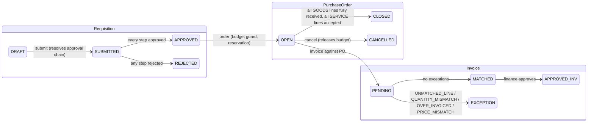
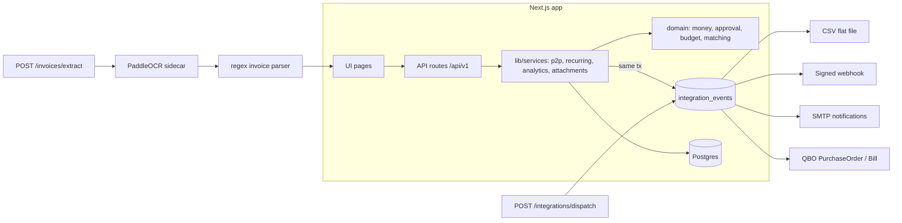

# HexProcure v0.1.0: Functional Specification (as built)

Written 2026-10-20 from the code on `main`; facts re-checked against the code on 2026-10-21.
This document describes what the software does today. Roadmap lives in
`ai-roadmap.md`; the review that accompanies this spec lives in `review-2026-10-20.md`.

## 1. Purpose and users

Self-hosted procure-to-pay for 10 to 50 person companies. Replaces email and
spreadsheets with a controlled loop: request, approve, order, receive, match
invoice, export to the accounting system.

| Role | Can do |
|---|---|
| REQUESTER | create and submit requisitions, order approved requisitions, send POs, record receipts, create and match invoices, upload attachments |
| MANAGER | everything above, plus approve or reject approval steps routed to MANAGER, cancel POs |
| FINANCE | everything above, plus approve invoices, approve steps routed to FINANCE, analytics, dispatch outbox, run recurring templates |
| ADMIN | everything, plus API tokens, QBO connect/disconnect, licence view, revoking a user's sessions, any approval step |

Auth: email + password (scrypt), HMAC-SHA256 signed session cookie (7 days,
`HttpOnly`, `SameSite=Lax`) backed by a server-side `sessions` row that logout or an ADMIN can revoke, plus machine API tokens (`Bearer hxp_…`, SHA-256
hashed at rest, ADMIN-managed, revocable). Middleware enforces CSRF origin
checks and in-memory rate limits (login and register 10/min, other `/api/*` GET and HEAD requests 300/min, other methods 60/min by default, per client IP and `/api/v1/<resource>` prefix) on every `/api/*` route.

## 2. Core flow

### 2.1 Requisition
- Created by any user against one supplier and one cost center, single currency (default EUR), with lines `{description, quantity, unitPriceMinor, kind: GOODS|SERVICE}`.
- Submit resolves the approval chain from `approval_rules` (ordered amount bands with `minMinor`, optional `maxMinor`, `approverRole`). Total falls in exactly one band; boundary amounts go to the higher band; open-ended bands act as escalation steps so one requisition can need several sequential approvals. Overlapping bands and mixed currencies are rejected when the chain is resolved on submit, and a submit with no matching rule fails.
- One `approvals` row per step. Approvers see only tasks routed to their role; ADMIN can decide any step. Reject on any step rejects the requisition.
- Order templates (`order_templates`, cadence MONTHLY / QUARTERLY / YEARLY, `nextRunDate`) generate DRAFT requisitions when `POST /order-templates/run` is called; idempotent per day via row locks.

### 2.2 Purchase order
- `POST /requisitions/:id/order` on a fully approved requisition creates a PO with lines mirrored from the requisition.
- Budget guard: monthly budget per cost center (`budgets`, keyed by `yearMonth`). PO creation reserves its total in `budget_reservations` inside one transaction with `SELECT … FOR UPDATE`, so concurrent orders cannot double-spend. Insufficient budget fails with `BUDGET_EXCEEDED` carrying the available amount. Cancel releases the reservation.
- PO PDF (`@react-pdf/renderer`) in two variants: `supplier` (no cost center or requester) and `internal`. `POST /purchase-orders/:id/send` emails the supplier variant via SMTP and writes a `PO_SENT` audit event; allowed only while OPEN.
- `GET /purchase-orders/:id/lines` returns the PO lines. Ordering fails with `INVALID_STATE` when the cost center has no budget for the month.

### 2.3 Goods receipt
- Receipts per PO line. GOODS: cumulative received ≤ ordered, enforced in the domain. SERVICE: acceptance flag instead of quantity.
- PO auto-closes when every GOODS line is fully received and every SERVICE line has at least one acceptance.

### 2.4 Invoice and matching
- Invoice `{supplierId, purchaseOrderId, number, lines[{poLineId?, quantity, unitPriceMinor, amountMinor?}]}`. Invoice number is unique per supplier.
- Matching (`src/domain/matching.ts`) checks each line: `UNMATCHED_LINE` (no or unknown PO line), `QUANTITY_MISMATCH` (cumulative invoiced > received), `OVER_INVOICED` (cumulative invoiced across invoices > ordered), `PRICE_MISMATCH` (deviation > max(2 %, 0.5 minor units)). `QUANTITY_MISMATCH` and `OVER_INVOICED` use the cumulative invoiced quantity including prior invoices. SERVICE lines compare cumulative `amountMinor` against the PO line amount (`OVER_INVOICED_AMOUNT`) and the accepted amount (`SERVICE_NOT_ACCEPTED`).
- Clean result → `MATCHED`; otherwise `EXCEPTION` with a structured exception list stored on the invoice. Only `MATCHED` invoices can be approved (FINANCE/ADMIN). Approval emits `INVOICE_APPROVED` to the outbox.

### 2.5 AI-assisted invoice intake
- `POST /invoices/extract` (multipart PDF/image) → PaddleOCR sidecar (`services/ocr`, FastAPI, self-hosted) returns text + per-line confidence → deterministic regex parser (`invoice-parser.ts`) extracts invoice number, issue date, grand total (EU decimal-comma aware, minor units), VAT ID, and a HIGH/LOW confidence flag. The parsed currency is always EUR.
- Output is a draft for a human to complete. The parser extracts no line items. When `ANTHROPIC_API_KEY` is set (model `claude-opus-5-5`, override with `INTEGRATION_LLM_MODEL`), an LLM proposes invoice lines from the OCR text (`linesSource: "llm"`, usage logged in `llm_usage`); otherwise `lines` is empty (`linesSource: "none"`). The route returns 501 unless `INTEGRATION_OCR_URL` is set.

### 2.6 Attachments
- Files on requisitions, POs, invoices. Allowlist pdf/png/jpeg/webp/txt/zip, ≤10 MB, stored on local disk (`file-store.ts`) under a random storage key. Delete by uploader or ADMIN.

### 2.7 Money
All amounts are integers in minor units wrapped in `Money` (`src/domain/money.ts`). Arithmetic refuses mixed currencies, fractional minor units, and negative results unless allowed. Supported currencies: EUR, USD, GBP, CZK, PLN, CHF (requisition default EUR); display uses each currency's own fraction digits.

### 2.8 Audit
Every state change appends to `audit_events` (`entityType`, `entityId`, `action`, `actorUserId`, `payload`). Append-only.

## 3. Integrations

- Transactional outbox: events `PO_CREATED`, `PO_CANCELLED`, `INVOICE_APPROVED`, `APPROVAL_REQUESTED`, `REQUISITION_DECIDED`, `INVOICE_EXCEPTION` are inserted in the same transaction as the business change.
- Dispatch runs through `POST /integrations/dispatch` (FINANCE/ADMIN, batch of 100) and, when `INTEGRATION_DISPATCH_INTERVAL_MS` is a positive integer, on an in-process timer (`compose.yaml` sets 60000). The timer does not register connectors; connectors are registered only inside the dispatch route, so timer runs deliver nothing until that route has run once in the same process. Events without a registered connector stay PENDING. Each connector declares which events it handles; delivery returns ok / retryable / non-retryable. Failed events stay PENDING with `attempts` and `lastError`.
- Connectors: CSV (RFC-4180, header + line rows), generic webhook (HMAC-SHA256 `X-HexProcure-Signature`, 4xx non-retryable, 5xx/429/network retryable), email (nodemailer, log-only without `SMTP_URL`), QuickBooks Online (payload mappers; OAuth connect/callback/disconnect/status routes exist, tokens AES-encrypted with `INTEGRATION_ENC_KEY`; vendor and item references are kept in `qbo_sync_map`; not yet run against a live Intuit sandbox).
- Routing: the registry keeps one connector per event type and the last one registered wins. Registration order is CSV, email, QBO (when `QBO_CLIENT_ID` and `QBO_CLIENT_SECRET` are set), webhook (when `INTEGRATION_WEBHOOK_URL` is set). So `PO_CREATED` and `INVOICE_APPROVED` go to the webhook when set, else QBO when configured, else CSV; `PO_CANCELLED` goes only to the webhook; `APPROVAL_REQUESTED`, `REQUISITION_DECIDED`, `INVOICE_EXCEPTION` and `INTEGRATION_ERROR` go to email.
- The CSV connector renders rows and counts bytes but writes no file; events it handles are marked DELIVERED.

## 4. Analytics
- `GET /analytics/summary`: approved-invoice totals per currency and top supplier per currency. FINANCE/ADMIN only.
- `GET /analytics/spend?groupBy=supplier|costCenter|month&from&to`: totals and document counts from approved invoices. FINANCE/ADMIN only (`groupBy` defaults to `supplier`).

## 5. UI surfaces
Dashboard, Requisitions (list, new, detail), Approvals inbox (inline approve/reject), Purchase orders (list, detail), Invoices (list, new, detail), Suppliers (list, detail), Attachments, Recurring templates, Analytics, Login. The requisition to PO to receipt to invoice flow runs in the UI and is covered by E2E tests. Server-rendered App Router pages with small client components.

## 6. API surface (all under `/api/v1`)

| Area | Endpoints |
|---|---|
| Auth | `POST auth/register`, `auth/login`, `auth/logout`; `GET/POST auth/tokens`, `DELETE auth/tokens/:id`; `POST users/:id/sessions/revoke` |
| Requisitions | `POST requisitions`, `POST requisitions/:id/submit`, `POST requisitions/:id/order` |
| Approvals | `POST approvals/:id/decide` |
| Purchase orders | `POST purchase-orders/:id/receipts`, `GET purchase-orders/:id/pdf`, `POST purchase-orders/:id/send`, `POST purchase-orders/:id/cancel`, `GET purchase-orders/:id/lines` |
| Invoices | `POST invoices`, `POST invoices/:id/match`, `POST invoices/:id/approve`, `POST invoices/extract` |
| Attachments | `GET/POST attachments`, `GET/DELETE attachments/:id` |
| Recurring | `GET/POST order-templates`, `POST order-templates/run` |
| Integrations | `POST integrations/dispatch`, `GET integrations/qbo/connect`, `GET integrations/qbo/callback`, `POST integrations/qbo/disconnect`, `GET integrations/qbo/status` |
| Analytics | `GET analytics/summary`, `GET analytics/spend` |
| Meta | `GET meta/options`, `GET meta/entities` |
| Licence | `GET license` (ADMIN) |
| Health | `GET /api/health` |

Errors: `{ error: { code, message } }`; domain errors mapped centrally in `lib/api/helpers.ts` (400 validation, 401/403 auth, 404, 409 state, 422 domain rule).

## 7. Data model (Postgres, Drizzle)
`users`, `sessions`, `suppliers`, `cost_centers`, `approval_rules`, `budgets`, `budget_reservations`, `requisitions`, `requisition_lines`, `approvals`, `purchase_orders`, `po_lines`, `receipts`, `receipt_lines`, `invoices`, `invoice_lines`, `api_tokens`, `order_templates`, `order_template_lines`, `integrations_connections`, `qbo_sync_map`, `attachments`, `audit_events`, `integration_events`, `llm_usage`. All money columns are `*_minor` integers with a `currency` text column.

## 8. Quality and operations
- Vitest: 50 test files, 421 tests against Postgres 16. Coverage thresholds are 80 % for branches, functions, lines and statements over `src/domain`, `src/lib/services` and `src/lib/api`.
- Playwright: 12 E2E tests in 7 files, run with `.env.e2e` (default port 3100).
- Migrations: `drizzle/0000` to `0009`, applied by `scripts/migrate.mjs` (the `migrate` service in `compose.yaml`).
- Deploy: multi-stage Dockerfile (standalone Next), `compose.yaml` with app, Postgres 16, OCR sidecar, one-shot migrate service. CI runs typecheck, lint, migrate, unit tests with coverage, build, Playwright and docker build; `claude-fix` workflow opens a fix PR on label.

## 9. Known gaps
- Rate limiting is in-memory and per instance; there is no Redis-backed limiter.
- The Intuit live sandbox smoke test (`npm run test:qbo-live`) has not been run, and production OAuth needs a public HTTPS redirect URI.
- The in-process dispatch scheduler delivers nothing until POST /api/v1/integrations/dispatch has run in the same process (it does not register connectors itself).
- The CSV connector renders rows and counts bytes but writes no file and exposes no download.
